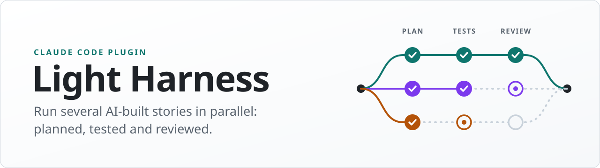

<p align="center">
  <picture>
    <source media="(prefers-color-scheme: dark)" srcset="docs/assets/banner-dark.svg">
    
  </picture>
</p>

<p align="center">
  <a href="LICENSE"></a>
  
  <a href="https://github.com/ehtesham1981/light-harness/actions/workflows/ci.yml"></a>
  
</p>

- **Several stories in parallel.** Each task runs in its own git worktree, so several Claude Code sessions build one project side by side.
- **Nothing left in your repo.** No files, settings or ignore entries are added to your branches; you get a branch with tests and code.
- **Gates the agent can't skip.** A human-approved plan, tests written and failing first, then an independent review.

<!-- Demo: a GIF of a task run or a `light-harness metrics` screenshot goes here. -->

<p align="center"><sub>Built by Ehtesham Ahmed (Algomade Consulting)</sub></p>

# Light Harness

A lightweight, gated development harness for [Claude Code](https://code.claude.com), for tasks where you want agentic work to be planned, test-driven, reviewed, and auditable. A task can be a standalone one-off or one story in a set that builds a project.

**It leaves nothing in your repo.** The harness runs from the plugin. Its contracts and audit trail live inside git, outside the working tree. No files, rules, settings, ignore entries or commits are added to your branches. What a task hands you is a branch with the work on it: tests and code, committed by the agent step by step.

Each task runs in its own folder inside the project, `.tasks/<name>/` (a git worktree on branch `task/<name>`), so several sessions can work in parallel on one repo. You always open the project's main folder, and the session that starts a task works on it. The task's contract is the source of truth, and four commands move the task through enforced gates:

```
task-init ─► Initialize ─► task-plan ─► Plan ─[human approves]─► task-implement ─► Build ─► task-review ─┬─► Done
                                                                        ▲                                │
                                                                        └──────────── Rework ◄───────────┘
```

| Command | Stage | What happens | Gate |
|---|---|---|---|
| `/light-harness:task-init` | Initialize | Starts the task in `.tasks/<name>/`, then interviews you for the goal, business rules, examples and acceptance criteria | ≥1 example, ≥1 testable acceptance criterion (AC) |
| `/light-harness:task-plan` | Plan | **explorer** subagent writes findings, risks, impact analysis, files in scope, interfaces, steps and test strategy | Every AC mapped to steps and tests; every rule over an input space has an oracle and a generated sweep; **a human approves**, and their name, the time and the plan hash are recorded |
| `/light-harness:task-implement` | Build | **test-author** subagent writes tests → stubs → **red gate** → implementation → **verify** | Red gate: the task's tests trace to every AC and sweep every input-space rule, fail on stubs, none pass vacuously, then get locked; tests from before the task must keep passing · Verify: locked tests unchanged and passing, saved probes passing, anti-gaming scan, anti-drift vs approved scope |
| `/light-harness:task-review` | Done / Rework | **reviewer** subagent checks every AC with evidence and logs issues with severity and defect class, while **sweeper** subagents sweep the input-space rules in parallel and the reviewer reproduces their findings | PASS refused while any Critical/High/Medium issue is unresolved, any AC is unticked, or verify fails |

## Install

In Claude Code:

```
/plugin marketplace add ehtesham1981/light-harness
/plugin install light-harness@light-harness
```

On Claude Code 2.1.275 or later, one step also works: `/plugin install light-harness --marketplace ehtesham1981/light-harness`.

From a local clone: `/plugin marketplace add ./light-harness`. To try it without installing: `claude --plugin-dir ./light-harness/plugins/light-harness`.

**Auto-install for a team:** add this to a shared project's `.claude/settings.json`, and Claude Code offers the plugin to anyone who opens the project. This is the one line of config you choose to add; the harness itself adds nothing.

```json
{
  "extraKnownMarketplaces": {
    "light-harness": { "source": { "source": "github", "repo": "ehtesham1981/light-harness" } }
  },
  "enabledPlugins": { "light-harness@light-harness": true }
}
```

**Prerequisites:** Python 3.9+ (found as `python3`, `python` or `py -3`), git, and your test runner (pytest by default). Works on macOS, Linux and Windows (Git Bash). The repo needs at least one commit, because a task folder is made from one.

## Use

Open the project's main folder (an existing repo, or a new one with a first commit) and start a task:

```bash
cd my-project
claude
```
```
/light-harness:task-init Invoice dedupe
```
This creates the task folder `.tasks/invoice-dedupe/` on branch `task/invoice-dedupe` and goes straight into the interview in the same session. If the task builds on a finished one, say so when asked. Then:
```
/light-harness:task-plan
```
Approve the plan **in your own terminal**, in the project's main folder. The command is interactive, and the agent is blocked from running it. `task-plan` prints the exact command with the plugin's path filled in. It looks like this (on Windows use PowerShell or Windows Terminal, and `python` instead of `python3`):
```bash
python3 "<plugin folder>/scripts/harness.py" approve --task invoice-dedupe --name "Your Full Name"
```
```
/light-harness:task-implement
/light-harness:task-review
```
In Claude Code sessions the command is on PATH as `light-harness`. Check progress at any time with `light-harness status --task invoice-dedupe`, or list all tasks with `light-harness tasks`.

After a PASS, `task-review` offers to finish the task. `finish-task` removes the task folder and keeps the reviewed work on its branch, which you merge or open a pull request from like any other branch. The contract and audit trail stay readable with `light-harness show <name>` and `light-harness log <name>`.

For another task, run `/light-harness:task-init <name>` in a new session in the same main folder. Several sessions can each work on their own task at once.

### Where everything lives

| What | Where | In your branches? |
|---|---|---|
| Task folder | `.tasks/<name>/`, a git worktree, ignored through `.git/info/exclude` and removed by `finish-task` | no |
| Live contract and stack config | `.tasks/<name>/.light-harness/contract.md` and `config.json`, ignored | no |
| Base-commit copies | `.tasks/<name>/.light-harness-base/`, written by `light-harness baseline`, ignored; moved aside to `.git/light-harness/` while the suite and probes run | no |
| Saved probes | the audit trail (`probes.json` and the scripts), run from `.tasks/<name>/.light-harness/probes/` against a fresh base export per probe in `.git/light-harness/` | no |
| Reusable verify run | `.git/light-harness/verify-cache-<name>.json`: the last fully passing run of the suite and probes, and the key it's valid for | no |
| Audit trail | `refs/light-harness/tasks/<name>`: one commit per gate event (task start, approval, baseline, red gate, unlocks, verdicts), each holding the contract and gate records plus a snapshot of the code at that moment | no (a hidden ref, not pushed by `git push`) |
| Finished work | the task's branch (`task/<name>`, or the name you pass to `finish-task --branch`), plus `refs/light-harness/done/<name>` so later tasks can build on it | the branch is the deliverable |
| Repo defaults | `.git/light-harness/config.json`, the last finished task's stack config, used to start the next task | no |
| Telemetry events | `.git/light-harness/telemetry/events.jsonl`, one JSON line per event (see [Telemetry and KPIs](#telemetry-and-kpis)) | no (inside `.git`) |
| Rules for the agent | the plugin's `rules.md`, added to the session's context by a SessionStart hook | no |
| Permission rules | enforced by the plugin's PreToolUse hook | no |

### Tasks and commands

```bash
light-harness start-task "<name>" [--from <finished-task>]   # new task folder .tasks/<name> + branch task/<name>
light-harness tasks                                         # tasks in progress and finished
light-harness <command> --task <name>                       # any stage command, for one task
light-harness finish-task <name> [--branch feature/x]       # Done task → remove folder, keep the reviewed work on its branch
light-harness show <name>                                   # print a task's contract
light-harness log <name>                                    # print a task's audit trail
light-harness metrics [<name>] [--json]                     # KPIs for tasks, agents and opted-in engineers
light-harness telemetry status                              # where events go, and whether you're opted in
light-harness baseline --task <name> <path…>                # base-commit copies of files (+ local imports) in .tasks/<name>/.light-harness-base/
light-harness baseline --task <name> --out <dir> <path…>    # the same, in a folder outside the repo (one per parallel sweeper)
light-harness probe add <script> --issue RV-n --task <name> # save a sweep that found a defect; verify re-runs it from then on
light-harness probe list|run --task <name>                  # show or run the saved probes
light-harness verify --fresh --task <name>                  # verify without reusing an earlier passing run
```

- **Your main branch is never touched.** The harness commits nothing to it, and nothing is merged automatically. You merge or open a PR from a finished task's branch when you're ready.
- **The branch is exactly what was reviewed.** `finish-task` refuses while the task folder has uncommitted changes, or while the branch differs from the code the reviewer passed.
- **Parallel sessions are safe.** Each task has its own folder, branch and contract, and each session sticks to its task with `--task`. The guard hook decides from each edited file's path which task's rules apply. While tasks are in progress it blocks edits to the main checkout, and it never lets the agent switch branches, merge, rewrite history, or add or remove worktrees.
- **Building on earlier work:** `--from <finished-task>` starts the new task from the finished one's code, tests and stack config. Independent tasks start from the current branch.
- **Existing tests:** a passed verdict records which tests pass. On an existing codebase, entering Build records them the first time. At the red gate, those tests may pass (and must keep passing at `verify`). Only the tests added in this task must fail on the stubs. AC numbers start at 1 in every task, because the red gate and `verify` only count the tests added or changed in the current task.
- **Task folder location:** `worktree_dir` in the task's config (default `.tasks`).

### Rules that hold for every input

Some rules cover an open-ended input space: "existing outcomes don't change", "the guard blocks every write into X", "the parser reads every legacy file". A handful of examples can't prove them, and when each stage takes its examples from the stage before, they all share one blind spot. A rewrite of a guard is the classic case: a precise parser that replaces a coarse heuristic turns "blocks too much" into "lets through anything it doesn't recognise", and each review round finds a few more instances of the same class. So for these rules the evidence is a **generated sweep checked against an oracle**; examples only illustrate.

- **Contract.** A business rule is `[Example]` (the default, untagged), `[Invariant]` (a property of every input) or `[Preservation]` (outcomes unchanged from the base commit, apart from listed changes). A tagged rule states its `Input space:`, `Oracle:` (the base-commit code, a reference implementation or a property), `Unacceptable failure:` direction and `Allowed changes:` as sub-bullets, and §8.4 has a `BR-n [sweep]` entry naming its `generator:` and `oracle:`. `check plan`, and so approval, refuses the plan otherwise; it also warns about untagged rules worded like "every" or "unchanged".
  ```markdown
  - BR-2 [Preservation]: commands the guard already blocks or allows keep their outcome
    - Input space: prefixes × command words × targets × separators, including ones the rule doesn't know
    - Oracle: the guard at the base commit (`light-harness baseline`)
    - Unacceptable failure: allowed now but blocked before; blocking more is acceptable only if listed
    - Allowed changes: EX-3, EX-4
  ```
- **Oracle from the base commit.** `light-harness baseline --task <name> <path…>` writes the base-commit versions of those files, with their local Python and JS/TS imports, to `.tasks/<name>/.light-harness-base/` (ignored, never committed). Old and new code can then run side by side. The guard blocks agent edits and Bash writes into it as best it can, and it never reaches a probe anyway: probes get a fresh export from git, outside the task folder. Tests turn it into a golden file under the test folder rather than reading it at run time: it isn't there in CI, and the harness moves it out of the task folder while the suite runs.
- **Tests.** The test-author writes a deterministic sweep per tagged rule (full cross product or fixed seed, including values the rule doesn't recognise), tagged `BR-n [sweep]` in its docstring or title (not a comment) and with `sweep` in its own name. The red gate and `verify` require one per tagged rule. A Preservation sweep passes on stubs that keep the old code, and the red gate accepts that test, by its tag and name, without `--allow-passing`. A kind tag the plan gate can't read (`[Preservation-rule]`, `(Invariant, Example)`) is refused rather than treated as an Example rule.
- **Review.** The reviewer runs its own sweep from dimensions it picks independently, records the method, sample size and differences, and names the defect **class** in the issues table's Class column. A sweep that found a defect is saved with `light-harness probe add`: it's kept in the task's audit trail, where agents can't change it, and every `verify` re-runs it, so a finding becomes a permanent check and later rounds cover earlier classes. A probe runs with its working directory at the task folder and gets, as its first argument, a fresh export of the base copies it recorded, made outside the task folder; exit 0 means the class is gone, 1 that it found differences, anything else that the probe broke. So that the code under test can't behave differently while it is checked: the test suite and the probes run as in CI, with the task's `.light-harness-base/` moved out of the task folder and no agent-session or harness markers in their environment (`CLAUDECODE`, `CLAUDE_CODE_*`, `CLAUDE_PROJECT_DIR`, `LIGHT_HARNESS_*`, the plugin on PATH; a project's own variables are kept); `verify` fails implementation code that names the harness's folders (`.light-harness-base`, `.light-harness`), and code that names the harness once probes are saved (a tool config that ignores those folders, or a domain term, can be declared in §10.3); and it warns about code that inspects its parent process. A task worktree still differs from CI in small ways (its `.git` is a file, its branch is `task/…`); code that tests for those stands out to the reviewer, and the committed sweep runs in CI too. Only a human can drop a probe (`probe drop <id> --name … --reason …`).
- **Parallel sweeps** (from 1.8). `task-review` starts the reviewer and up to `parallel` `light-harness:sweeper` subagents in one go, one per tagged rule (several rules per sweeper when there are more rules than that). `status` lists the rules on its `Sweeps:` line. Each sweeper exports its own base copies with `baseline --out <dir>`, so sweepers never touch the task's `.light-harness-base/` or wait on a test run. The folder must be new or empty and outside the repository, so nothing already there is replaced. Sweepers write a report file: method, sample size, differences, a proposed class, a probe-ready script and the base files it used. They never edit the contract. The skill passes the report files' paths to the same reviewer. The reviewer reads them itself, re-runs every sweep script and checks its numbers, then reproduces each difference, logs the issues, saves the probes and writes §11.3, so only one agent writes §11. The reviewer also decides whether any rule without a sweeper needs a sweep.

  Budgets: a sweep should finish in about 60 s with at most about 5,000 inputs (pairwise or stratified sampling beyond that), and a saved probe in about 30 s. Saved probes run up to `parallel` at a time, each with its own base export. Because they run at the same time, a probe keeps its temp files in a fresh temp folder of its own. A task whose config has no `parallel` key (approved before 1.8) runs its probes one at a time. A probe that runs longer than `probe_timeout` seconds (default 600) counts as broken.
- **Re-reviews look at what changed** (from 1.8). From the second round on, the reviewer:
  - diffs against the code snapshot of the last `verdict` event (the code the previous round judged)
  - re-checks every Open and Fixed issue
  - reviews in full whatever the diff touches
  - re-confirms each AC whose code, what that code imports or reads, or its tests changed

  Sweeps go to rules whose code changed, to rules an Open or Fixed issue names, and to any other rule the reviewer judges needs one. Every saved probe still runs in `verify`.
- **Rework** fixes the class, not the listed instances; `verify` warns about a regression test whose inputs all come from its issue's text. `metrics` counts **same class reopened**: issues in a later review round whose class matches an earlier one, or that the reviewer set back to Open after the implementer marked them Fixed (the audit trail records the issues table when each review starts and at each verdict).

### Human-only commands
Run these in your own terminal, in the project's main folder, as `python3 "<plugin folder>/scripts/harness.py" <command>`. The agent prints the exact path when one is needed.
```bash
approve --task <name> --name "Full Name"                        # approve the plan
unlock-tests --task <name> --name "Full Name" --reason "..."    # let tests be revised after the red gate
forget <name>                                                   # delete a finished task's contract and audit trail
uninstall [--dry-run] [--force]                                 # remove every trace of Light Harness from this repo
telemetry opt-in --as "<nickname>" [--repo]                     # attribute your harness events to a nickname you choose
telemetry opt-out [--repo]                                      # stop attributing them
probe drop <id> --task <name> --name "Full Name" --reason "..."  # remove a saved probe that verify re-runs
```

### Uninstall, and repos set up by 1.x

`uninstall` removes the task refs, `.git/light-harness/`, the lines in `.git/info/exclude` and the empty `.tasks/` folder. Task branches are kept. It refuses while tasks are in progress (`--force` drops their folders but keeps their branches), and while a finished task's work is on no branch.

Light Harness 1.3 and earlier copied itself into the work repo: `contract.md`, `scripts/harness.py`, `.harness/`, `.env.example`, a rules block in `CLAUDE.md`, permission rules in `.claude/settings.json` and lines in `.gitignore`. In such a repo, `start-task` asks you to run `uninstall` first. Uninstall removes only the harness's own content and keeps whatever else those shared files hold. It leaves the changes uncommitted for you to review. It keeps 1.x `done/*` tags and any 1.x task still in progress, which carries its own copy of the old harness: finish that task with its copy before you rely on 1.4. Commits that 1.x made stay in your history.

## What enforces what

| Mechanism | What it stops |
|---|---|
| Stage gates (`set-status`) | Skipping stages, building without approval, entering review with failing verification |
| Plan hash | Changing requirements or the plan after approval. Any edit to contract §1–§8 voids the approval and red gate |
| Git-anchored audit trail | Task start, approval, baseline, red gate, test unlocks and verdicts are commits on `refs/light-harness/tasks/<name>`, each with a code snapshot. Gates are recomputed from that history, not from a side file. The red gate's snapshot is what locked tests are compared against |
| Guard hook (PreToolUse) | Code edits before Build or during Review, edits to locked tests, hand edits of the Status line and harness-owned contract blocks, edits to the harness's files and to agent permissions (settings, agents, commands, skills under `.claude/`) unless the approved plan lists them by a `.claude/` path in §8.1. Bash: human-only commands, faked terminals, branch switching, merges, rebases, resets, amends, branch/tag deletion, worktree changes, `rm -rf`, and tampering with the audit trail or the telemetry settings. Network commands and pushes ask first, and `.env` files are unreadable. It fails closed in a harness repo if Python is missing, and it's inert in other repos |
| Plan gate (`check plan`, `approve`) | An `[Invariant]` or `[Preservation]` rule without an input space, oracle, failure direction, allowed changes or a §8.4 sweep entry; an unknown rule kind |
| Red gate | New tests that pass before implementation (apart from tagged Preservation sweeps), ACs not traced to this task's tests, input-space rules with no `[sweep]` test, skipped tests |
| `verify` | Saved probes that fail; implementation code that names the harness's folders, or (once probes are saved) the harness itself, so it could tell a check apart (a tool config that ignores the folders, or a domain term, is declared in §10.3 and becomes a warning); tests that read the base copies at run time (the suite runs with them moved out of the task folder); input-space rules with no `[sweep]` test; modified, deleted or added protected files; test-runtime sniffing; skip/xfail/only markers; changes outside approved scope; stack config changed after approval; changes to agent permissions not listed under `.claude/` in the approved §8.1 (listed ones are a warning for the reviewer). Warns on swallowed exceptions, coverage exclusions, mocks in implementation code, comparisons against test literals, regression tests that only use the inputs quoted in their issue, code that names the harness before any probe is saved, and code that inspects its parent process |
| Reused verify runs | Re-running the suite and probes on unchanged code before the final gate. The implementer's last `verify`, `set-status Review` and the reviewer's `verify` reuse a run only if all of these hold: it passed fully (the suite, every red-gate test and every probe); it's under 30 minutes old; and its key still matches. The key covers the tracked and untracked files, the names of ignored files, the config, the saved probes, the approval and red-gate records, the base commit, the harness version, the interpreter and the run environment. A run is stored only if the key is the same after it as before it. Any other real run deletes the stored one, so a failing `verify --fresh` is never followed by a reused pass. Every other `verify` check runs each time, and the report says when a run was reused. **`verdict pass` never reuses a run:** it runs the suite and probes on the code it passes. So a stale or forged stored run can at most get a task into Review, where the reviewer's checks and the final gate still apply. Editing an ignored file's content (say `.env`), or outside state the tests read (a database, the network, the clock), doesn't invalidate a stored run: use `verify --fresh` then |
| `finish-task` | A branch that differs from the code the reviewer passed |
| Reviewer + verdict gate | Subtle gaming (special-casing example values), unmet ACs and rules, missing risk mitigations, unjustified deviations |

**Limits:** the agent has a shell, so the harness makes bypass costly and visible rather than impossible. For example, the agent could write git objects through a command the guard doesn't recognise, or a script could write a stored verify run into `.git/light-harness/`. A stored run is never trusted by `verdict pass`, so the most it could do is get a task into Review. The defences are the guard, gates recomputed from git, and a reviewer that re-runs `verify` and reads the audit trail. For high-stakes tasks, run the review in a fresh session and glance at `light-harness log <name>`.

## Telemetry and KPIs

The harness records what happens to each task as local events. `light-harness metrics` turns them, together with the audit trail, into KPIs for the task, the agents that worked on it and, if they opt in, the engineers who drove it.

**What's recorded, and where.** Each event is one JSON line in `.git/light-harness/telemetry/events.jsonl`. That file is inside `.git`, so it's never committed or pushed. `uninstall` deletes it, and `forget <task>` drops that task's events. These are the events:

| Event | When | Main attributes |
|---|---|---|
| `command` | every gate and lifecycle command (`set-status`, `check`, `redgate`, `verify`, `verdict`, `approve`, `unlock-tests`, `start-task`, `finish-task`, `probe`) | `ok`, `reason` (first line of a refusal), `ms`; plus test counts for the red gate, failure kinds for `verify`, issues by severity and `same_class_reopened` for a verdict, and the unlock reason |
| `stage` | each status change | `from`, `to` |
| `guard` | each guard hook block or ask | `decision`, `rule` (such as `locked-test`, `stage`, `git-surgery`, `network`), `tool`, `agent_type` |
| `agent` | subagent start and stop (SubagentStart/SubagentStop hooks) | `phase`, `agent_type`, `agent_id`; the stop carries `run_s` |
| `session` | session start and end in a harness repo | `phase`, `source` / `reason` |
| `turn` | a main-agent turn starts (UserPromptSubmit) or ends (Stop/StopFailure, or the next prompt or session end after an interrupt) | `phase`, `stage`. Start: `gap_s` (time since the session's previous turn ended), `response_s` (that gap up to the human-gap cap), `capped`, `gap_start`. Stop: `turn_start`, `turn_s`, `wait_s` (time in the turn spent waiting on a human), `agent_s` (`turn_s` − `wait_s`), `interrupted` |
| `wait` | the agent waited on a human inside a turn: a permission dialog (PermissionRequest until the tool starts) or an `AskUserQuestion` until it's answered | `kind` (`permission` or `question`), `tool`, `wait_start`, `wait_s` |

Some gate events also carry durations already worked out, so an OTel dashboard can sum or average them directly: a successful `approve` has `wait_s` (from the plan being put up for approval), and a `verdict` has `review_round`, with `lead_time_s` and `first_pass` on the final pass.

Every event also carries `ts`, `harness` (version), `repo`, `task`, `session` (the Claude Code session id) and `actor` (`agent` or `human`). It never holds code, contract text, test output or file contents. Events without a task are attributed through their session.

**KPIs** (`light-harness metrics`, or `metrics <task> --json`):
- **Task:** lead time, time in each stage, review rounds, first-pass review yield, plan approvals, test unlocks, and (from 1.7) same class reopened: issues in a later review round whose Class matches an earlier round's, or that the reviewer set back to Open after the implementer marked them Fixed (the audit trail records the issues table when each review starts and at each verdict). A rising count is the sign of example-anchored checks on a rule that holds for every input; those are the tasks to examine. These come from the audit trail, so they cover tasks from before 1.5 too.
- **Time split** (from 1.6): each task's total time (its lead time, or its age while open) split three ways, overall and by stage:
  - **Agent:** time the main agent spent working in turns, not counting waits on a human inside them. Subagents run inside turns, so they're already included.
  - **Human:** time spent waiting on a human. That's the gaps between a turn ending and the next prompt in the same session (up to the human-gap cap, 2 hours by default), plus permission dialogs and `AskUserQuestion` answers inside turns.
  - **Idle:** everything else, such as when no session was working on the task, or the part of a gap beyond the cap.

  When several sessions work on one task at once, their time is merged, with agent time counted ahead of human time, so the three always add up to the total. `metrics` shows a time-split table, `metrics <task>` shows the breakdown by stage, and `--json` holds all of it. Tasks run before 1.6 have no turn data, so they show `-`.
- **Agent:** red-gate refusals, `verify` failures by kind, all gate refusals per gate, guard blocks by rule, and subagent runs and time per agent type.
- **Engineer:** approval wait (from the plan being ready to it being approved), median response time between turns, test unlocks, prompts (guard asks that stopped for the human) and tasks and sessions. These are **per engineer only for engineers who opted in**. Otherwise they appear only in aggregate.

**Engineer identity is opt-in, under a nickname.** By default events carry no engineer at all. An engineer opts in by running `telemetry opt-in --as "<nickname>"` themselves, in their own terminal. Agents can't run it. From then on, their events carry that nickname and nothing else about them. The nickname can be anything they like, and it's stored in their own git config (`lightharness.engineer`), for all their repos, or for one repo with `--repo`. `telemetry opt-out` stops it. Telemetry never uses the git user name or email, or the name given to `approve`. The audit trail still records that name, because it's part of the approval itself.

**Tokens and cost.** Turn on Claude Code's own telemetry (`CLAUDE_CODE_ENABLE_TELEMETRY=1`) and send it to the same OpenTelemetry collector. Its events carry `session.id`, and so do the harness's, so token use and cost can be broken down by task and stage.

**Settings** (the guard blocks agents from changing them):

| Setting | Effect |
|---|---|
| `LIGHT_HARNESS_OTLP_ENDPOINT` or `git config lightharness.otlpEndpoint` | Also send each event as an OTLP/HTTP log record to this collector (e.g. `http://localhost:4318`). Best effort, with a 2 s timeout. Hook events are sent from a detached process, so a slow collector never delays a turn |
| `LIGHT_HARNESS_OTLP_HEADERS` or `git config lightharness.otlpHeaders` | Extra headers for the collector, `key=value,key2=value2` |
| `LIGHT_HARNESS_HUMAN_GAP_CAP` or `git config lightharness.humanGapCap` | How much of a gap between turns counts as human time (the rest is idle), e.g. `2h`, `90m`, `600s` or `600`. Default `2h` |
| `LIGHT_HARNESS_TELEMETRY=0` or `git config lightharness.telemetry false` | Record nothing |

Telemetry never changes a gate's outcome. If an event can't be written or sent, the command carries on as if telemetry were off.

## Customise per task

- **Stack:** during planning, set `test_cmd`, `junit_arg` / `junit_path`, `test_globs` and `protected_globs` in `.tasks/<name>/.light-harness/config.json`. The config is frozen once the plan is approved, and the next task in the repo starts from it. Example for Jest: `"test_cmd": ["npx","jest","--ci","--reporters=default","--reporters=jest-junit"]`, `"junit_arg": ""`, `"junit_path": ".light-harness/junit.xml"`, with `JEST_JUNIT_OUTPUT_FILE=.light-harness/junit.xml` set in the environment.
- **Review speed:** `parallel` (default 3, 1 to 4) is how many sweeper subagents and saved probes run at once. Without the key (configs approved before 1.8), probes run one at a time. `probe_timeout` (default 600) is how many seconds a saved probe may run before it counts as broken. Set them before approval, like the rest of the config.

## Repository layout

```
.claude-plugin/marketplace.json      marketplace (this repo is installable directly)
plugins/light-harness/
  .claude-plugin/plugin.json
  skills/task-{init,plan,implement,review}/SKILL.md    stage commands
  agents/{explorer,test-author,reviewer,sweeper}.md    subagents
  hooks/hooks.json         SessionStart → scripts/session.sh, PreToolUse → scripts/guard.sh,
                           Session/Subagent start and stop, UserPromptSubmit, Stop,
                           PermissionRequest, PostToolUse → scripts/telemetry.sh (async,
                           except SessionEnd)
  bin/light-harness        the command line (a Python launcher for scripts/harness.py)
  rules.md                 working rules added to sessions in repos with tasks
  scripts/harness.py       gate engine
  scripts/hook_guard.py    guard rules (file edits, reads, Bash)
  scripts/guard.sh         cross-platform Python launcher for the guard
  scripts/session.sh       puts bin/ on PATH, passes on the session id, adds rules.md to the session
  scripts/telemetry.py     event log, opt-in engineer nickname, OTLP export, KPIs
  scripts/telemetry_hook.py, telemetry.sh   session, subagent, turn and wait events (fail open)
  template/                contract and default stack config for new tasks
tests/selftest.sh          end-to-end gate test (also run in CI)
```

## Contributing

1. Change things under `plugins/light-harness/`.
2. Run `bash tests/selftest.sh` (Linux or WSL; it needs `script` from util-linux). It drives toy tasks through every stage, including deliberate gaming attempts that must be caught. It also checks that the repo, the main checkout and the task branches end up free of any harness residue.
3. Run `claude plugin validate --strict .`
4. Bump `version` in `plugins/light-harness/.claude-plugin/plugin.json` and `__version__` in `scripts/harness.py`, so users get the update via `/plugin update`.

CI runs the self-test on Python 3.9 and 3.12, validates the manifests, and checks the hook launcher and a task start on Windows.

## Citing Light Harness

Light Harness was designed and created by Ehtesham Ahmed (Algomade Consulting). If you use it, or adapt its design or code in your own harness, workflow or writing, please cite it. GitHub's **Cite this repository** button gives the citation in APA and BibTeX, from [CITATION.cff](CITATION.cff).

## License

Copyright 2026 Ehtesham Ahmed. Licensed under the [Apache License, Version 2.0](LICENSE).

If you redistribute Light Harness or a work derived from it, under any name, keep the [NOTICE](NOTICE) file with it and mark the files you changed (sections 4(b) and 4(d) of the License). Versions up to 1.6.0 were released under the MIT License, and 1.6.1 onward are under Apache 2.0.

"Light Harness™" is a trademark of Ehtesham Ahmed, and "Algomade™" is a trademark of Algomade Consulting. The License grants no right to use either for your own product or fork (section 6), other than to say where the work comes from.
